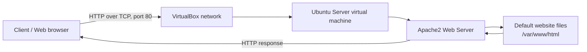
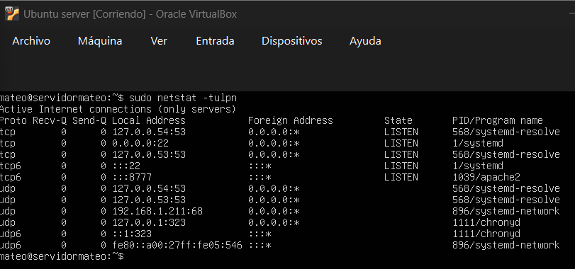

# Apache Web Server Installation

**Student:** Mateo Daniel Ortuño Ovando\
**Environment:** Ubuntu Server running in VirtualBox\
**Date:** \[Write the date reported by your Ubuntu server\]

> **Important:** The commands below are the steps to run in your own
> Ubuntu virtual machine. Outputs shown as examples are illustrative;
> replace them with the real output from your terminal. I cannot access
> your VirtualBox machine, so I cannot truthfully provide its actual IP
> address, server date, command output, or screenshots.

## Step 1. Understand the target architecture

In this assignment, an Ubuntu Server virtual machine will run the Apache
HTTP Web Server. A client (for example, the web browser on the host
computer) will connect to the virtual machine over the network using
HTTP. Apache listens for incoming connections on TCP port **80** by
default and returns the requested web page.

### Architecture diagram



The exact connection from the host to the virtual machine depends on the
VirtualBox network configuration. With **Bridged Adapter**, the VM
normally receives an address on the same network as the host. With
**NAT**, port forwarding may be needed to reach the web server from the
host. Host-only networking allows communication between the host and the
VM, but not necessarily the wider network.

## Step 2. Check the server information

Run these commands in the Ubuntu Server terminal, one at a time:

``` bash
hostname
whoami
hostname -I
date
```

What each command does:

-   `hostname` displays the computer's host name.
-   `whoami` displays the currently logged-in username.
-   `hostname -I` displays the IP address or addresses assigned to the
    server. If it prints nothing, check the VM's network configuration.
-   `date` displays the date and time according to the Ubuntu server.
    Record the date shown in your report.

**Record your actual results here:**

``` text
Hostname: [Servidormateo]
User: [mateo]
IP address: [192.168.1.211]
Server date and time: [mie-28-oct-2026-33:35:46-UTC]
```

Example output format (your values will be different):

``` text
ubuntu-server
mateo
192.168.1.120
Wed Oct 28 22:10:00 CET 2026
```

## Step 3. Update Ubuntu package information

Run:

``` bash
sudo apt update
```

Enter your password if prompted. While typing a password in the
terminal, characters usually do not appear; this is normal.

This command downloads the latest package lists from the configured
repositories. It refreshes information about available software; it does
not by itself upgrade every installed package.

**Expected result:** the command should finish without fatal errors. The
exact package counts and messages depend on the system.

Example of a successful ending:

``` text
Reading package lists... Done
Building dependency tree... Done
Reading state information... Done
```

## Step 4. Install Apache

Run:

``` bash
sudo apt install apache2
```

When asked whether you want to continue, type `Y` and press Enter.

This installs Apache and its required packages. On Ubuntu, the service
is usually named `apache2`.

**Expected result:** package installation messages appear and the
command completes. On many Ubuntu installations, the service starts
automatically after installation.

## Step 5. Check Apache's status

Run:

``` bash
sudo systemctl status apache2
```

Look for a line similar to:

``` text
Active: active (running)
```

**Meaning:** `active` means systemd considers the service active, and
`running` means the Apache service process is currently running. The
screen may open in a pager; press `q` to return to the terminal.

If the service is not running, check the error messages before
continuing.

## Step 6. Check whether Apache starts automatically

Run:

``` bash
sudo systemctl is-enabled apache2
```

Expected output:

``` text
enabled
```

**Meaning:** `enabled` means Apache is configured to start automatically
during the appropriate system startup process. It does not, on its own,
guarantee that the service is currently running; use `systemctl status`
for that.

## Step 7. Practise systemctl service actions

The general command structure is:

``` bash
sudo systemctl ACTION SERVICE
```

For this exercise, the service is `apache2`.

### 7.1 Stop Apache and check the status

``` bash
sudo systemctl stop apache2
sudo systemctl status apache2
```

After stopping it, the status should no longer say `active (running)`.
Depending on the system, it may show `inactive (dead)`. Press `q` to
exit the status screen.

`stop` stops the currently running service. It does not normally disable
automatic startup.

### 7.2 Start Apache again and check the status

``` bash
sudo systemctl start apache2
sudo systemctl status apache2
```

Look for:

``` text
Active: active (running)
```

`start` starts the service if it is not running. It does not itself
configure the service to start automatically at boot; that is what
`enable` is for.

### 7.3 Reload Apache's configuration

``` bash
sudo systemctl reload apache2
sudo systemctl status apache2
```

A successful reload normally applies supported configuration changes
without fully stopping and starting the service. The command may return
to the prompt without printing a success message; check its exit status
and service status if you need to verify it.

**Difference between `start` and `reload`:**

-   **`start`** starts the service when it is stopped.
-   **`reload`** asks an already running service to reload its
    configuration, usually while keeping the service running. It does
    not install Apache and does not start a stopped service.

## Step 8. Check the listening port

Run:

``` bash
sudo netstat -tulpn
```

Options: - `-t`: show TCP sockets. - `-u`: show UDP sockets. - `-l`:
show listening sockets. - `-p`: show the process using the socket, where
available. - `-n`: show numeric addresses and port numbers instead of
resolving names.

If Ubuntu reports `netstat: command not found`, install the package that
provides it and try again:

``` bash
sudo apt install net-tools
sudo netstat -tulpn
```

Look for a TCP row with a local address ending in `:80` and a state of
`LISTEN`. The process column may mention `apache2`, although process
details can vary.

Example only:

``` text
Proto  Recv-Q  Send-Q  Local Address       Foreign Address  State   PID/Program name
tcp    0       0       0.0.0.0:80          0.0.0.0:*        LISTEN  1234/apache2
```

Your output may show `*:80`, `[::]:80`, a different PID, or additional
rows. Do not copy the example as if it were captured from your own
server.

### Questions

**1. What port number is used by Apache?**\
By default, Apache serves HTTP on port **80**. Confirm this in your own
`netstat` output by finding the listening TCP row ending in `:8777`.

**2. What protocol is used: TCP or UDP?**\
The normal HTTP web server listener uses **TCP**. In the output, find
the row whose `Proto` column says `tcp`. UDP is not the normal transport
for traditional HTTP on port 80.

**3. What does `LISTEN` mean?**\
`LISTEN` means a TCP socket is waiting for incoming connection requests.
It indicates that a process is prepared to accept connections on that
address and port; it does not prove that a client can reach the server
through every network or firewall.

## Step 9. Screenshots and evidence

The assignment asks for a screenshot of the port information. Capture
the real output from your own Ubuntu terminal.

Recommended evidence: 
1. A screenshot of `hostname`, `whoami`,
`hostname -I`, and `date`. 


2. A screenshot of
`sudo systemctl status apache2` showing `Active: active (running)`. 


3. A
screenshot of `sudo systemctl is-enabled apache2` showing `enabled`.


4. A 
screenshot of `sudo netstat -tulpn` showing the TCP listener on port
8777.


For the required port screenshot, make sure the command and the row
containing `:8777`, `tcp`, and `LISTEN` are visible. In VirtualBox, you
can take a screenshot using your host operating system's screenshot
tool. Insert it into this Markdown file in the same folder using a
relative image path, for example:

``` markdown

```

Create a folder named `screenshots` beside this Markdown file and save
your screenshot there as `apache-netstat.png`, or change the image path
to match the filename you actually use.

## Final checklist

-   [ ] Recorded hostname, username, IP address, and server date from
    Ubuntu.
-   [ ] Ran `sudo apt update`.
-   [ ] Installed Apache with `sudo apt install apache2`.
-   [ ] Checked that Apache is `active (running)`.
-   [ ] Checked that Apache is `enabled`.
-   [ ] Stopped Apache and checked its status.
-   [ ] Started Apache again and checked its status.
-   [ ] Reloaded Apache's configuration.
-   [ ] Checked the listening port with `sudo netstat -tulpn`.
-   [ ] Added real terminal screenshots and replaced all placeholders
    with actual output.

**Conclusion:** Apache2 is the web server software installed on the
Ubuntu virtual machine. When running, it listens for HTTP requests on
TCP port 8777 by default and responds with website content from its
configured document root, commonly `/var/www/html`.
